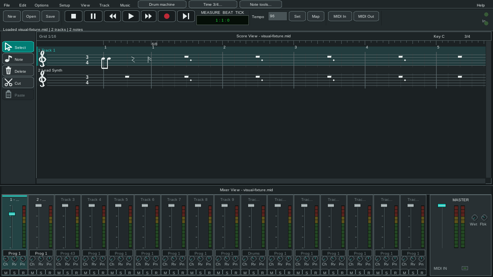

<!--
    Project: OpenSesh
    File: README.md
    Purpose: Introduce the editor and point users to practical documentation.
    Responsibilities: explain the product, capabilities, platforms and first steps.
    This file does not contain contributor setup details.
-->

# OpenSesh

## A MIDI workspace for writing and shaping songs

OpenSesh keeps a multi-track score view and a sixteen-channel mixer in one
desktop editor. Edit notes, arrange drum phrases, shape a mix, and hear changes
through the built-in synthesizer or a SoundFont you choose.

The built-in sound means a hardware synthesizer is optional. OpenSesh can also
send and receive MIDI through native endpoints on Windows and Linux. Add WAV
clips to a project, record a live part, or export a WAV mix and a ProTracker MOD
file.

## What you can do

- Open, edit, and save Standard MIDI Files, including notes, tracks, tempo and
  meter maps, and supported MIDI controller events.
- Draw, select, move, resize, quantize, duplicate, and transpose notes in the
  score view. Undo and redo MIDI and audio edits together.
- Build reusable drum phrases, preview them, and insert them into a song as
  ordinary channel 10 drum notes.
- Balance sixteen MIDI channels with volume, pan, chorus, reverb, mute, solo,
  and record-arm controls.
- Play through the included synthesizer or load a user-supplied SoundFont.
- Record from a MIDI device, use the on-screen performance keyboard, or
  transcribe a single melodic line from microphone input where the host
  supports it.
- Place external WAV clips on the song timeline and export a complete WAV mix.
  Export MIDI notes as a four-channel ProTracker MOD module.
- Switch between Desktop and Touch controls and choose Light, Dark, or Black
  themes.

## Get the editor

The current version is **0.9.0-dev**. Download the package for your system from
[GitHub Releases](https://github.com/fbxl-sj0/OpenMidiSesh/releases). Extract
the complete archive and run <code>OpenSesh.exe</code> on Windows or
<code>opensesh</code> on Unix-like systems. Package-specific runtime
requirements are listed in [Dependencies](docs/DEPENDENCIES.md).

| Platform | Editor and built-in sound | Native MIDI endpoints |
| --- | --- | --- |
| Windows x86_64 | Desktop editor | WinMM input and sfxlib output |
| Linux x86_64 | Desktop editor | ALSA Sequencer input and output |
| FreeBSD, NetBSD, OpenBSD, Haiku x86_64 | Desktop editor | Not available; built-in sound and editing work |
| Android | Touch-oriented package | Not available; built-in sound and editing work |

Android is built through a separate packaging script. It shares the editor,
score, gestures, and synthesizer with the desktop program.

## Build from source

The repository includes the omaGUI source used by the editor. Windows and Linux
quick-start commands are:

~~~powershell
powershell -NoProfile -File ./build_editor.ps1 -OutputPath ./build/opensesh.exe
~~~

~~~bash
OUTPUT_PATH="$PWD/build/opensesh" bash ./build_editor.sh
~~~

See [Building OpenSesh](docs/BUILDING.md) for toolchain requirements, platform
notes, and Android instructions.

## Documentation

- [User guide](docs/USER_GUIDE.md): the main window, editing, playback, and
  exporting.
- [Architecture](docs/ARCHITECTURE.md): application components and data flow.
- [Building](docs/BUILDING.md): compiler setup and build commands.
- [Dependencies](docs/DEPENDENCIES.md): bundled and host-provided components.
- [Contributing](CONTRIBUTING.md): source conventions and contribution workflow.
- [CI and releases](docs/CI.md): automated build coverage and publishing checks.

## License

OpenSesh is licensed under [GPL-3.0-or-later](COPYING). Dependency licenses
and attributions are listed in [Third-Party Notices](THIRD_PARTY_NOTICES.md).

<!-- end of README.md -->