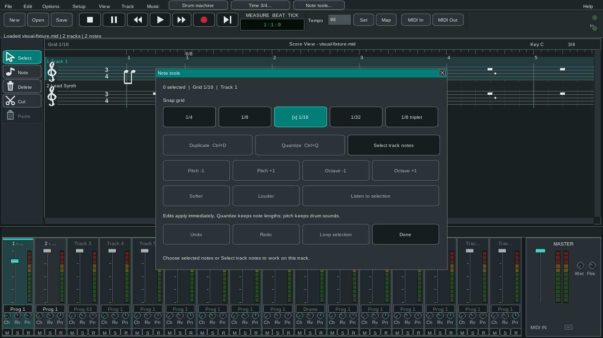
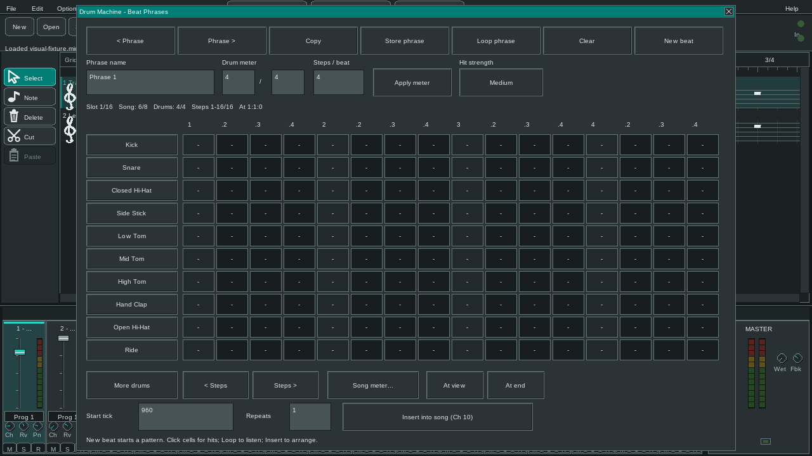

<!--
    Project: OpenMidiSesh
    File: docs/USER_GUIDE.md
    Purpose: Help musicians use the editor's visible controls and workflows.
    Responsibilities: describe the score, mixer, transport, sound and file tasks.
    This guide does not document internal test procedures or build tooling.
-->

# User Guide

OpenMidiSesh edits Standard MIDI Files and OpenMidiSesh projects. Its score is a
practical note-editing view paired with a channel mixer. You can start with an
empty song, work from an existing MIDI file, or keep external WAV clips in a
project.

## Start a song

Launch OpenMidiSesh with no argument to create an empty song. To open a file from
the command line, pass its path:

~~~powershell
./openmidisesh.exe "C:/Music/song.mid"
~~~

Use **File > Open** to select a Standard MIDI File or an OpenMidiSesh project.
**File > New** creates a fresh song. If there are unsaved edits, Open and New
ask before discarding them.

Use **File > Save** after editing. A standalone MIDI file is saved as a
Standard MIDI File. An OpenMidiSesh project keeps its project file, companion MIDI
file, and WAV clip references together. Project saves do not copy the WAV files;
keep those files available at their saved paths.

## Main window

| Area | What it is for |
| --- | --- |
| Menus and shortcut buttons | Open common commands, choose a song meter, open Note tools, and launch the drum phrase editor. |
| Transport and tempo | Stop, pause, rewind, play, change playback speed, record, step, set the starting tempo, and open the tempo or meter map. |
| Score View | See tracks as labeled staff rows, navigate time and tracks, and select or edit notes. The view follows the playhead during playback and live recording. |
| Score tool rail | Select, add, delete, cut, or paste notes. The Note tool opens a palette of durations and accidentals. |
| Mixer View | Select a channel and adjust its level, pan, chorus, reverb, mute, solo, and record arm. The master section controls overall level and echo. |

The score is designed for editing MIDI notes. It is not a full music
engraving or page-layout system.

## Place and edit notes

1. Choose **Note** on the score rail.
2. Choose a note value in the palette, then click the desired track and time.
3. Press **Space** or **F5** to hear the song.
4. Select **Select** to move or edit existing notes.

Click a note to select it. Shift-click adds or removes individual notes from the
selection. Drag over empty score space to select notes in a region. Drag
selected notes to move them on the snap grid; Alt-drag a single note to change
its length. Use Delete to remove a selection.

**Edit > Note Tools** offers Duplicate, Quantize, pitch and octave changes,
velocity changes, selection playback, and looped selection playback. The snap
grid also controls where new notes are placed and how far notes move.
**Ctrl+Z** undoes an edit; **Ctrl+Y** or **Ctrl+Shift+Z** redoes it.

Use **Track > Add Track** or **Track > Remove Track** to change the track list.
Select a track in either the score or mixer to make it the active track. Open
**Track > Properties** to rename it or choose from the scrollable list of 128
named General MIDI instruments. Program numbers are shown from 001 to 128.
The program change applies to the selected track's MIDI channel;
tracks that share a channel also share its instrument. Event editors provide
controls for note properties, tempo and meter changes, and MIDI controller
events.

## Play, record, and mix

The transport buttons at the top of the window control playback and recording.
**Space** toggles Play and Pause. **Ctrl+Space** plays the selected notes.
**F2** stops, **F3** rewinds, **F4** switches speed while stopped, **F5** plays,
**F6** records, **F7** pauses, **F8** starts step recording, and **F9** plays
the current step. The **Map** command opens tempo, meter, and key-signature
changes across a song.

During live recording, **F7** pauses note capture and the recording clock.
Incoming MIDI remains monitored through the built-in synth and any open MIDI
output. Press **F7** again to resume; paused time is not added to the take.

Each mixer strip represents a MIDI channel. The channel controls shape the
software-synth mix. **M** mutes, **S** solos, and **R** arms the channel for
step recording. The master fader controls overall software playback; **Wet**
and **Fbk** adjust the master echo.

To record from a MIDI device, select **MIDI In**, choose an available input,
and start recording. Native MIDI input is available on Windows and Linux. MIDI
output can be selected with **MIDI Out** on those platforms. The built-in
synthesizer remains available alongside MIDI output.

Open **Options > Performance Keyboard** to play notes with the on-screen piano
or the computer keyboard. Use Record to capture a played part. The **Hum /
Whistle Input** command can turn a single melodic line from microphone audio
into notes when the host provides audio input; it is intended for one note at
a time, not chords or full-band transcription.

## Make drum phrases

Open the drum editor with the **Drum machine** button or
**Music > Drum Machine / Phrases**. Choose a phrase slot, then click grid cells
to add or remove hits. Select Soft, Medium, or Hard before placing new hits.
Use **Copy** to make a variation and **New beat** to create a starter pattern.

A phrase has its own meter and step count. **Loop phrase** previews the pattern.
Choose **Insert into song** to add its hits to the song's Drum phrases track as
channel 10 notes. **Store phrase** keeps the pattern in the current song.
Save the MIDI or project after storing phrases to keep them on disk. Changing a
phrase later does not rewrite notes already inserted into the song.

Use **At view** to place a phrase at the left edge of the current score view or
**At end** to place it after the song. The **Song meter** control changes the
song's notation and measure guides; a drum phrase's meter does not change the
song meter.

## Choose a sound and work with audio

Open **Options > Load SoundFont** to choose an SF2 bank. Select
**Options > Use Built-in Synth** to release it and return to the included
synthesizer. SoundFonts are user supplied and are not included in packages.

The **Audio** editor lets you add PCM WAV files, place clips at song ticks, and
adjust their gain. Project files store paths to those WAV files instead of
embedding them. The Audio editor can also capture a WAV from the default
microphone or line input when that capability is available.

**File > Export WAV Mix** renders the software playback and placed WAV clips to
a PCM WAV file. The export does not include sound sent to external MIDI
hardware. **File > Export ProTracker MOD** writes the MIDI notes as a MOD
module; the format has four playback channels, so dense passages may be
simplified.

## Change the interface

**Options** offers Light, Dark, and Black themes, plus Desktop and Touch
interaction profiles. Touch mode uses larger controls. One finger taps, drags,
or pans the score. Two fingers pan and adjust horizontal time zoom or vertical
staff and track density.

The menus and dialogs support keyboard navigation. Use **Tab** and
**Shift+Tab** to move between available controls, **Enter** or **Space** to
activate a focused control, and **Escape** to dismiss a menu or dialog.

## Keyboard shortcuts

| Shortcut | Action |
| --- | --- |
| Space | Play or pause |
| Ctrl+Space | Play selected notes |
| Ctrl+N / Ctrl+S | New / Save |
| Ctrl+Z / Ctrl+Y | Undo / Redo |
| Ctrl+C / Ctrl+X / Ctrl+V | Copy / Cut / arm Paste |
| Ctrl+D / Ctrl+Q | Duplicate / Quantize |
| Ctrl+1 / Ctrl+2 / Ctrl+3 | Zoom in / normal zoom / zoom out |
| Ctrl+F / Ctrl+Shift+F | Fit project / fit tracks |
| F2–F9 | Stop, rewind, speed, play, record, pause, step record, step play |

<!-- end of docs/USER_GUIDE.md -->
